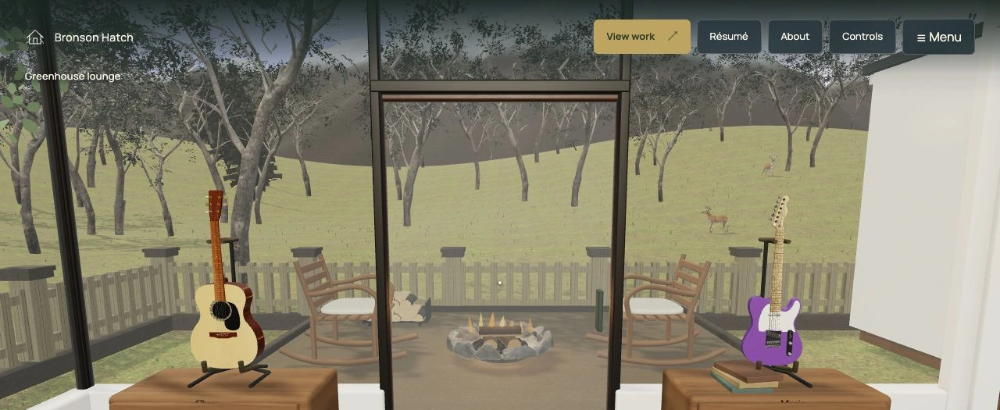
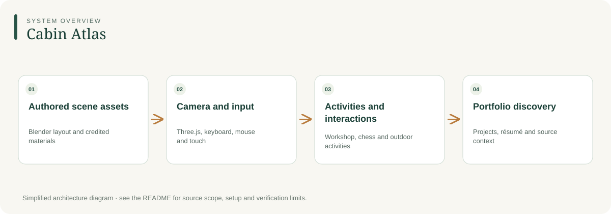

# Cabin Atlas

An interactive 3D portfolio home built with TypeScript, React, Three.js, Blender, and GLSL.

I wanted a portfolio that could be explored while keeping professional work easy to reach. Cabin Atlas combines a navigable cabin with a project interface, résumé, woodworking, chess, golf, and snowboarding.

## Explore it

[Open BronsonHatch.com](https://bronsonhatch.com). Choose **View work** for the project collection or explore the cabin. The site exposes controls and device options in its interface. Touch input uses the project's landscape layout.

## What I built

Blender layout and prepared assets → Three.js scene → activity and animation controllers → React portfolio interface → browser-local saved progress.

My work includes scene construction, object interaction, camera/input behavior, activity logic, and the portfolio presentation. The screenshot is a saved application capture, not a claim that every feature in a concept image is implemented.

## Source and review

This is a public showcase. Full application source remains in the private portfolio repository, so this repository does not contain an independently runnable game.

The source project uses Node 22.13+, `npm ci`, `npm run dev`, and a vinext production build. Those commands belong to the private application; they do not run from this showcase. The source repository's release review records its checks and remaining limits. Physical iPhone/iPad performance and accessibility require separate device testing; viewport screenshots do not establish them.

## Assets and limitations

Original authored scene work is combined with credited third-party assets. The full project records Quaternius CC0 characters, Poly Haven CC0 materials, MIT Three.js components, regional terrain sources, and individual asset credits. Golf hazards/contours, sports physics, and avatar motion include authored approximations rather than surveyed or calibrated sports models. No third-party 3D models, music, personal scrapbook, or terrain files are bundled here.

[Use and attribution](USE-AND-ATTRIBUTION.md). The showcased project is independently built; third-party assets retain their own licenses.

